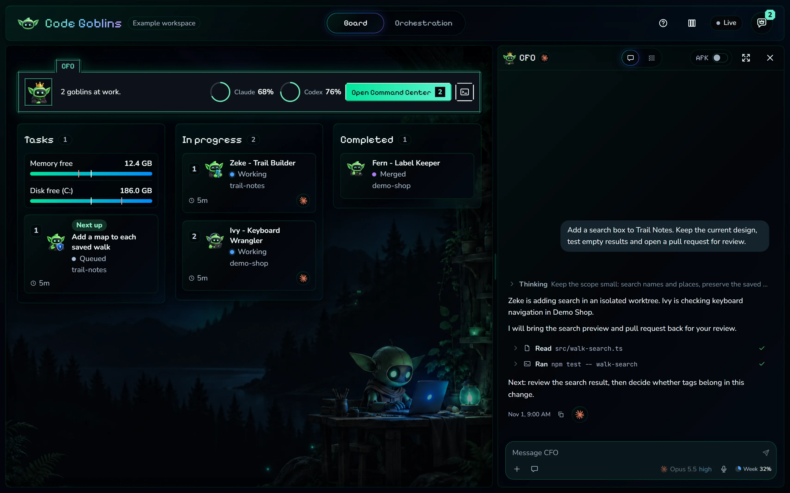
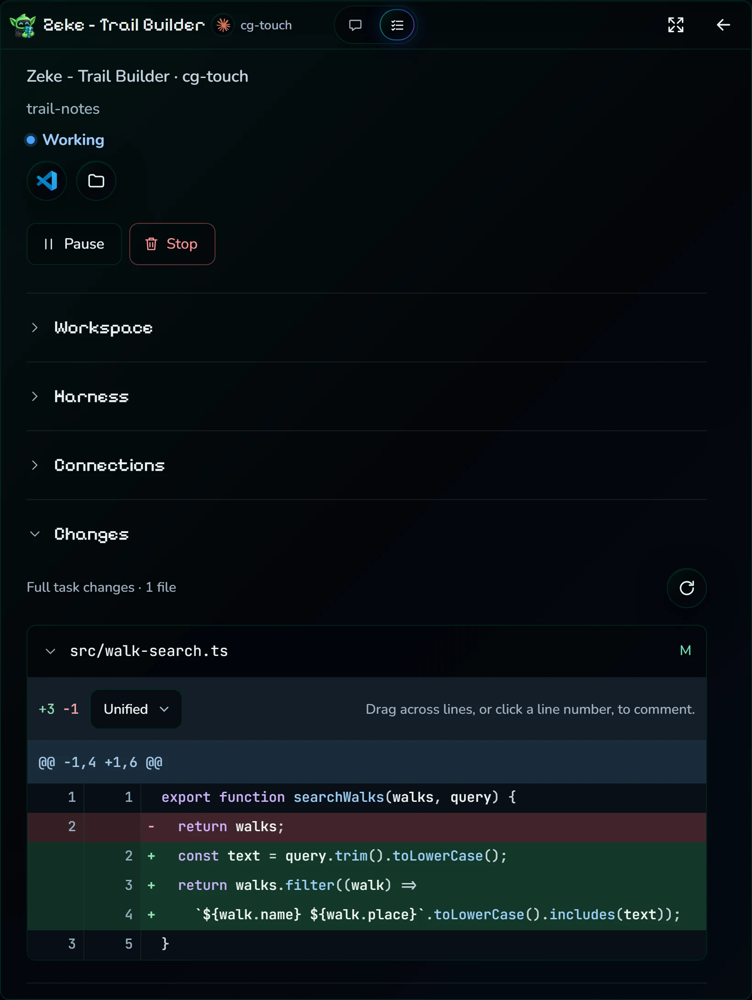
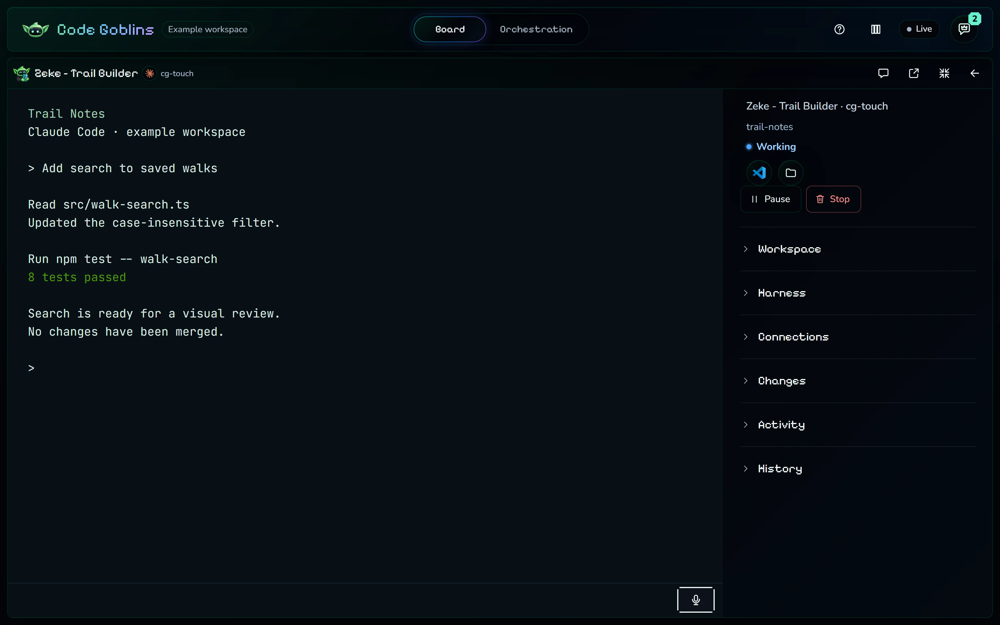
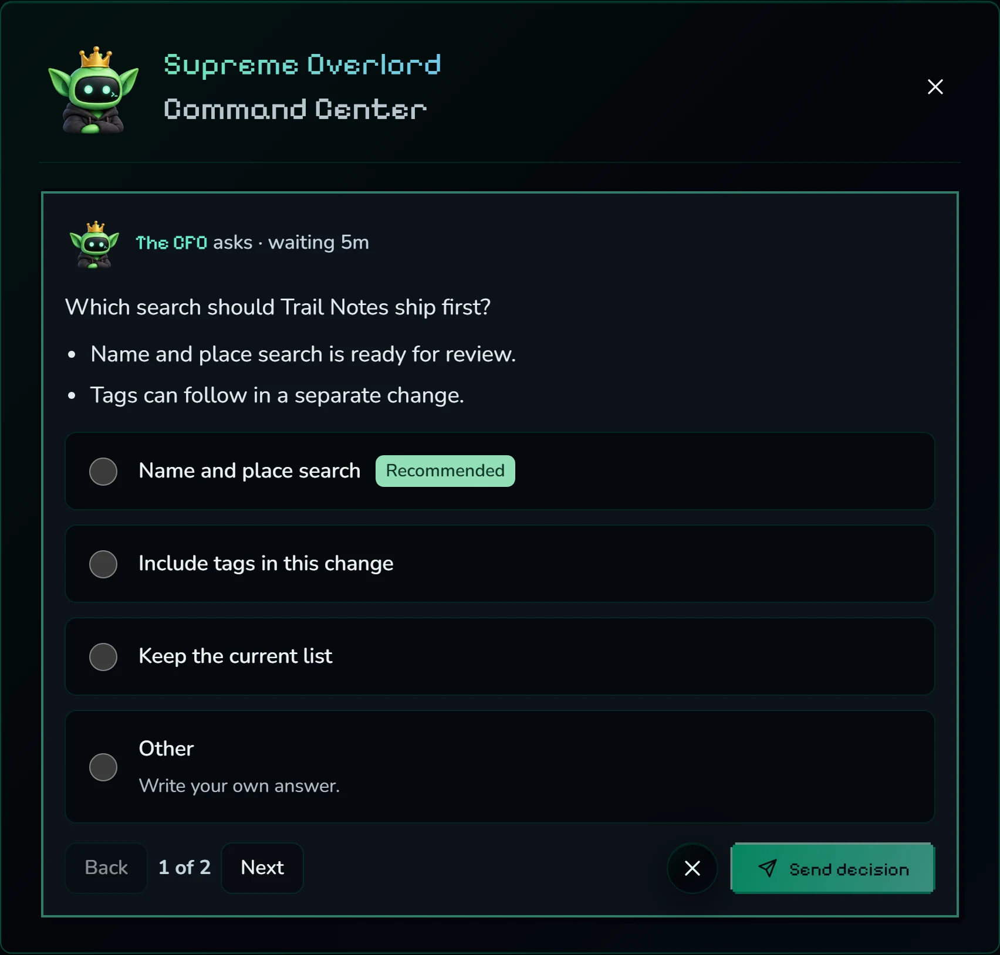
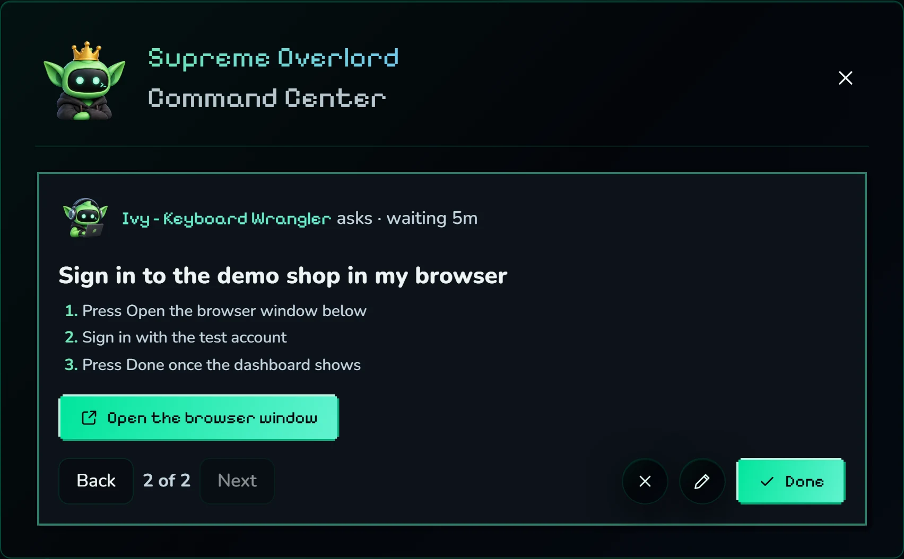
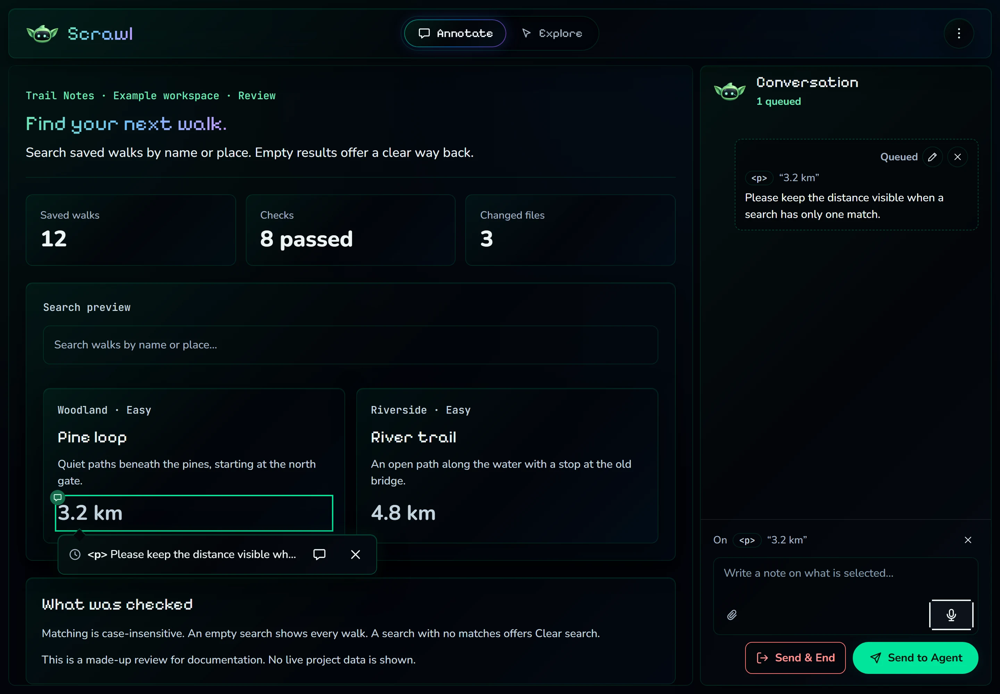
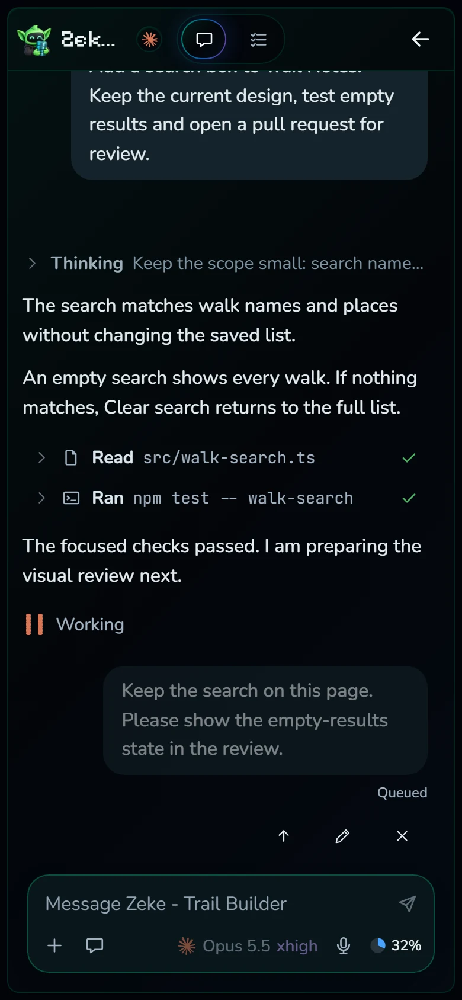

<h1 align="center">Code Goblins</h1>

<p align="center"><strong>Talk to one agent. Ship with a team.</strong></p>

<p align="center">
  A Windows app for working with a crew of coding agents.<br />
  Give the CEO an outcome.
  Follow the goblins as they work.
  Review the result.
</p>

<p align="center">
  
  
  
</p>

<p align="center">
  
  <br />
  <sub>Every screenshot shows a disposable example workspace with made-up projects, tasks and conversations.</sub>
</p>

<p align="center">
  <a href="https://github.com/fpresta0607/code-goblins/releases/latest/download/CodeGoblinsSetup.exe"><strong>Download for Windows</strong></a>
  · <a href="#quick-start">Quick start</a>
  · <a href="#using-the-board">Explore the app</a>
  · <a href="#your-phone">Connect your phone</a>
  · <a href="docs/install.md">Installation guide</a>
</p>

The **CEO** (Chief Executive Officer) is your supervisor and main conversation.
It breaks a request into tasks, gives **goblins** isolated git worktrees, follows their progress and brings decisions back to you.
Workers can use **Claude Code, Codex or pi**, with a harness, model and effort suited to the task.

- **See the work.** A board of queued, active and completed tasks, with a conversation and task details for each goblin.
- **Stay involved when it matters.** Steer a task, inspect its changes, answer a decision or annotate a review.
- **Keep your place.** Sessions run independently of the window; closing the app does not stop the fleet.
- **Deliver with evidence.** Review, tests and CI back the result, with bounded repair cycles and explicit merge authority.

## Quick start

### Install

Download and open [`CodeGoblinsSetup.exe`](https://github.com/fpresta0607/code-goblins/releases/latest/download/CodeGoblinsSetup.exe), or run this in PowerShell:

```powershell
irm https://github.com/fpresta0607/code-goblins/releases/latest/download/install.ps1 | iex
```

You need Windows and a signed-in coding harness.
The installer includes the desktop app and the `goblins` command, sets up the tools it needs and opens the app.
Run `goblins` to choose and sign in to the CEO's harness; `goblins setup` lets you choose again.
Claude Code is recommended for the fullest CEO integration; the setup explains the differences for Codex and pi.
Your harness uses its own account and model-provider configuration.
See [installation, prerequisites and fresh-PC checks](docs/install.md).

### Give the CEO its first task

1. Open **Code Goblins** from the Start menu, or run `goblins --board`.
2. Open the **CEO** panel and tell it which repository to use and what result you want.
   For example: “In my trail-notes repository, add a search box for saved walks. Keep the current design, test empty results and open a pull request for review.”
3. Follow the task cards as the CEO queues and dispatches the work.
   Click a goblin to open its conversation; choose **Task** for its workspace, controls, changes and history.
4. Send a follow-up to the CEO or that goblin when you want to steer it.
   Open **Command Center** when the app needs a decision, sign-in, review or command from you.
5. Inspect **Task → Changes** and the pull request, give feedback and tell the CEO when to merge.
   Closing a panel or the window leaves the work running.

The desktop opens with **Classic**, the harness's native terminal.
For **Modern Chat**, click the session's picture in the panel header and choose **Modern chat**; **Terminal** in the same menu goes back to the native terminal.
You can also choose Modern under **Task → Workspace → Chat**.
The hero above shows Modern selected.

## Using the board

### Follow a goblin

**Board** groups work into **Tasks**, **In progress** and **Completed**.
Open a card to follow the goblin, or use **Orchestration** for the crew's graph and child processes.
The memory and disk meters show whether the machine has room for more work.
Queued tasks have **Start**; running tasks have **Pause** and **Stop**, and paused tasks have **Resume**.

In the panel, **Chat** opens the conversation and **Task** opens the work details.
**Maximize** gives the panel the window, with the task details beside the conversation on a wide screen; **Restore** returns to the board.
Open **Workspace** to find the branch and working folder, **Harness** to inspect its engine, and **Changes** to load the files you want to review.
**Files on GitHub** opens the pull request's complete diff.

<p align="center">
  
  <br />
  <sub>Example workspace: inspect one task's controls and changes without leaving the board.</sub>
</p>

### Chat, Terminal and steering

Modern Chat presents prompts, replies, folded thinking and tool results as a conversation.
Type in the message box and press **Enter** to send; **Shift+Enter** adds a line.
The composer offers files, the session's permission mode, model and effort, plus local dictation where available.
Type `/` for harness commands or `@` for files.
On a phone, **Clear message**, the trash button beside **Speech history**, clears the whole unsent typed or dictated draft without sending it, interrupting the session or touching queued messages; text already in the native Terminal's input is edited there.

When a harness question or picker that something you typed or sent asked for appears in Modern Chat, it shows above the box as a list to pick from, and one a wake line or a notice opened stays in the terminal; **Terminal** in the style menu of the session's picture shows the terminal itself, and **Modern chat** returns to the conversation.
The native terminal keeps the harness's own keyboard controls and prompts.
**Open in Windows Terminal** offers another view of the same session on the PC.

<p align="center">
  
  <br />
  <sub>Example workspace: Classic shows the harness's terminal; Modern is a saved display choice.</sub>
</p>

To change direction, send a short follow-up to the relevant conversation.
A message reads **Queued** at the end of the chat while the board holds it, as it holds one to the CEO for a short undo window and, until its turn ends, a command to a busy goblin that its harness would not run mid-turn: **Edit** takes it back into the composer and **Cancel** withdraws it.
**Send now** is available according to the message's delivery state and harness, and presses the harness's own send-now key, which interrupts a working turn; a request that cannot proceed explains why.
After handoff, the harness's [delivery states](docs/native-board.md#the-message-box) determine the label and available controls.
Use the native Terminal for the harness's other interruption controls; **Pause** and **Stop** in Task control the task's session.
See [conversations, terminal navigation and controls](docs/native-board.md).

### Command Center

Open **Command Center** in the top bar for the items waiting on you.
A decision card explains the question, offers named choices and accepts your own answer through **Other**.
Pick an answer and press **Send decision**.

<p align="center">
  
  <br />
  <sub>Example workspace: answer a concrete decision and let the CEO continue.</sub>
</p>

A browser step arrives as a card with the reason, the page and the steps only you can take.
Open it to sign in, approve access or complete the requested check, then mark it done.
For a step tied to the goblin's browser, the card shows that browser's screen: take control there, and hand it back once the step is done.
Credential fields store secrets in the vault rather than sending their values through the conversation.
A command card shows the exact command before you press **Run** and records how it ended.

<p align="center">
  
  <br />
  <sub>Example workspace: a browser step stays with the task that needs it.</sub>
</p>

### Review and annotate

Expand **Task → Changes**, open a file and select lines to send an inline comment to the CEO.
For visual work, open the **Scrawl** review linked from Command Center.
Select an element or text to annotate it, or write in the page's conversation.
Press **Send to Agent** to deliver the collected feedback, or **Send & End** when the review is finished.

<p align="center">
  
  <br />
  <sub>Example review: comments stay attached to the part of the result you are discussing.</sub>
</p>

Scrawl is the review surface provided by the Code Goblins build of `lavish-axi`.
It is optional: a missing review surface does not stop other work.
See the [board and review guide](docs/native-board.md) and the [review-surface skill](.agents/skills/lavish/SKILL.md).

### Your phone

1. Connect [Tailscale](https://tailscale.com/download) on the Windows PC and phone using the same personal account.
2. On the PC, open **CEO → Task → Remote access** and turn on **Tailscale**.
3. Open the private HTTPS link shown there on your phone while Tailscale is connected.
4. To open review pages too, enable the separate **Scrawl reviews** switch on the PC.
   On iPhone, Safari's **Share → Add to Home Screen** keeps the board beside your apps.

<p align="center">
  
  <br />
  <sub>Example workspace at phone width: follow a conversation and inspect a queued follow-up.</sub>
</p>

Remote access is optional and owner-only; it does not publish the board to the internet.
The Windows PC must remain running and reachable.
Phone terminals support touch scrolling, clipboard paste, pictures and text copying.
Follow the [phone setup and troubleshooting guide](docs/remote-access.md) for Tailscale approval, private reviews and app badges.

### AFK mode

AFK is your explicit switch for letting the CEO make decisions while you are away.
Turn it on from the CEO's controls, then review the recorded decisions when you return.
It does not grant the agent authority over steps reserved for you.
The switch shows loading or refusal feedback when it cannot change state.
Turning AFK off opens a report of what changed, decisions made for you and work still under way.
Use **Change answer** to revise a decision, **Go through what needs you** to handle pending items, or **Open your last AFK report** in the CEO's Task view to reopen it.
See the [AFK contract](docs/contract/afk.md) for authority, limits and the return report.

## Opening, closing and restarting

Closing the desktop window, browser or attached terminal stops no work.
**Start at login** can bring the app back after sign-in; the fleet can resume work a restart ended.
Use task controls when you intend to pause or stop a goblin.
See [desktop and session behavior](docs/native-board.md) for recovery and native-terminal details.

### Everyday commands

Run these in a terminal of your own:

| Command | Use it to |
| --- | --- |
| `goblins` | Set up or open the CEO, with a choice to attach or open the board. |
| `goblins --board` | Open the board and bring back the remembered CEO when needed. |
| `goblins attach` | Attach to the CEO's native terminal; **Ctrl+]** detaches. |
| `goblins status` | Print the board link and whether the supervisor is running. |
| `goblins setup` | Choose the CEO's harness again. |
| `goblins resume` | Bring back the CEO and goblins whose terminals ended. |
| `goblins update` | Install the latest published release. |

See [conversation recovery and fresh starts](docs/native-board.md#a-ceo-whose-terminal-ended) for when reopening the CEO starts a new conversation.

### Core commands

Use `goblins help` to list topics, then ask for one command, such as `goblins help auth request`.
The [help reference](docs/commands/help.md), [operator contract](AGENTS.md) and [pipeline guide](docs/pipeline.md) cover fleet operation and verification levels.
See the [update command reference](docs/commands/update.md) for installing a candidate build and recovering an update.
See the [memory command reference](docs/commands/memory.md) for startup memory retrieval, budget reports and read-only migration and retention plans.

For persistent Command Center reviews:

```text
goblins review --id <stable-id> --title "<what to look at>" [--task <id>] [--image <path>]... [--lavish <url|html-file> [--reopen]]
```

Use `--reopen` only at the owner's request to revisit an ended review.
See the [review command reference](docs/commands/review.md) for withdrawal and clearing.

### Updates and uninstall

**Update Code Goblins** in Command Center offers published releases; `goblins update` does the same from your terminal.
Updates verify release downloads, keep the home and running sessions, and roll back a build whose board does not start.
See [updating and what it preserves](docs/install.md#updating).

The program folder retains only the current build once older copies are no longer in use.
The janitor retries removal of old copies and leaves the folder alone during an unfinished update.
Verified rollback and recovery copies in `state\update` are kept.

### Uninstall

Use **Settings → Apps → Installed apps → Code Goblins → Uninstall**, or run `goblins uninstall`.
By default, uninstall saves the home's `data` and `config` folders and unlanded goblin work in `Code Goblins kept` in your user folder, then removes the home and stored credentials.
See [uninstall options and retention details](docs/commands/uninstall.md).

## Your data

The CEO home is `%LOCALAPPDATA%\CodeGoblins` by default, or the folder selected through `GOBLINS_HOME`.
It holds fleet state, briefs, the backlog, project settings, credentials, memory, isolated worktrees and caches outside your repositories.
Your directives live in `data/overlord.md`; durable shared knowledge lives in `data/memory/`, indexed by `MEMORY.md`.
See the [CEO home contract](docs/contract/home.md#the-ceo-home) and [instruction and context load map](docs/load-map.md).
Existing checkout homes retain their [legacy checkout activation boundary](docs/contract/ownership.md#legacy-checkout-activation).

## Safety model

- Each goblin works in an isolated worktree, and dirty or unlanded work is preserved.
- Worktrees begin with tracked files; project configuration must explicitly name any additional development env files to copy.
- Authentication is checked before dispatch; tasks receive only the declared credentials and MCP access they need.
- Review and repair budgets are bounded, and unresolved gate findings do not become automatic approvals.
- Merges require your authority, including any explicit `yolo` or AFK delegation; eligible green pull requests can also land through the documented merge-train policy.
- Run cards execute only after you press **Run**; browser sign-ins and other owner steps remain yours.
- The installer backs up and merges its narrow Command Center permission rules into Claude Code settings; [the installation guide](docs/install.md) explains those changes.
  These rules cover filing cards; `goblins answer` and `goblins send` receive no added permission because their messages instruct workers.

Code Goblins coordinates delivery; it is not an operating-system sandbox.
Keep branch protection and restrict production credentials for sensitive projects.
The board runs locally by default; coding harnesses may contact their model providers according to their own configuration.
See [authentication](docs/contract/authentication.md), [delivery and merge authority](docs/contract/delivery.md) and [project runtime contracts](docs/project-runtime.md).

## Development

Clone this repository to work on Code Goblins itself.
A source build needs Go and Node.js, and must build the frontend before the Go binary can embed it:

```powershell
cd frontend
npm ci
npm run build
cd ..
go run ./cmd/goblins gate prepush
go build ./cmd/goblins
```

`goblins gate prepush` selects checks for the change; CI and merge trains provide the required delivery evidence.
Use [CONTRIBUTING.md](CONTRIBUTING.md) for development conventions and the [pipeline guide](docs/pipeline.md) for affected checks, reports and gate policy.
For a development install, see [building and installing from source](docs/install.md).

### Repo layout

| Path | Purpose |
| --- | --- |
| `cmd/goblins/` | Windows CLI and launcher. |
| `frontend/` | Board, conversations, task panels and Command Center. |
| `internal/` | Native terminal hosting, dispatch, supervision, credentials and delivery. |
| `.agents/skills/` | Repository-owned procedures and review-surface integration. |
| `docs/` | Installation, phone access, operator contracts and development guides. |

## Project lineage

Code Goblins began from ideas and code in [First Mate](https://github.com/kunchenguid/firstmate) and retains its MIT attribution.
It is an independent project; First Mate is not an upstream dependency you need to install or sync.

## Contributing

Issues and pull requests are welcome.
Read [CONTRIBUTING.md](CONTRIBUTING.md) and keep changes focused on reducing intervention while preserving evidence that the result is correct.

## License

MIT.
See [LICENSE](LICENSE) and [THIRD_PARTY_NOTICES](THIRD_PARTY_NOTICES).
